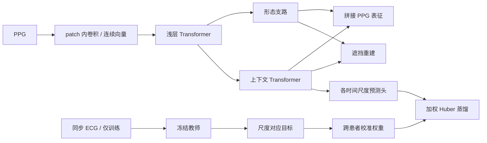

# TempoBridge

**ECG 辅助训练、PPG 单模态推理的时间尺度校准基础模型研究基座。**

TempoBridge 实现一条可以执行和审计的研究路线：先学习 PPG 本身的表示，
再用跨患者交叉拟合估计不同时间尺度 ECG 表征的可预测性，最后进行选择性蒸馏。
主要假设是：统一的跨模态模仿可能造成尺度相关的负迁移；有证据的选择与形态保护可以改善它。
这是假设，不是已经证明的新理论或顶会性能结论。仓库未包含临床数据或真实数据预训练权重。

## 架构



- 基础配置：6 层 Transformer、维度 256、8 头，前 2 层受保护；RMSNorm、RoPE、SwiGLU。
- 输入是固定时长 patch 的**连续向量**，没有离散码本或词表。
- 形态支路读取浅层 token；上下文支路读取完整序列。最终表征为两路均值池化的拼接。
- PPG 自监督更新整个学生；ECG 蒸馏默认只更新上下文层和预测头。
- 两个尺度分别实际裁剪、分别编码，短尺度教师看不到裁剪外的长上下文。
- 校准预测器按患者划分，目标归一化在每个拟合折内完成；评分按患者平衡。
- 无 ECG 或零权重样本仍参加 PPG 自监督。权重固定，不通过蒸馏损失学习。
- 对外 `forward(ppg)` 只接受 PPG。导出文件不含教师、校准器、蒸馏头或重建头权重。

代码为独立实现，参考 MantisV2 的通用 Transformer 组件选择和 PulseBound 的严谨信息边界分析。
**不是 Mantis 的逐行移植，不兼容其 checkpoint；没有复制 PulseBound 源码。**
详见 [方法与数学边界](docs/METHOD.md)、[相关工作与贡献边界](docs/RESEARCH.md)。

## 安装

Python >= 3.10，PyTorch >= 2.4。请先按硬件安装 PyTorch，再安装项目。
本地使用独立 `.venv`；不会改动原有 Python 环境。

```powershell
cd TempoBridge_backbone
python -m venv .venv
.\.venv\Scripts\python.exe -m pip install torch --index-url https://download.pytorch.org/whl/cpu
.\.venv\Scripts\python.exe -m pip install -e ".[dev]"
```

上述安装用于 CPU 跑通验证。实际服务器训练时按服务器硬件另行安装合适的 CUDA 版 PyTorch。
仓库不要求 D 盘或特定用户目录，所有数据、输出和 checkpoint 路径均为 CLI 参数。
下面的 `python` 均指已安装本项目的环境；Windows 也可以直接使用 `.\.venv\Scripts\python.exe`。

## 一次运行完整闭环

```powershell
python scripts/smoke.py --output runs/smoke
python -m pytest -q
```

smoke 自动执行：合成数据 → 数据审计 → PPG 预热 → ECG 预训练 → 校准 → 蒸馏 → 导出 → 提取测试表示。
合成信号仅验证工程和优化流程，**不能作为生理有效性或临床任务提升的证据**。
`configs/smoke.json` 用小模型和 CPU；`configs/base.json` 用正式架构和 CUDA bf16。
另提供 `configs/laptop_8gb.json` 供将来选择：同一正式架构，batch=4、累积8次，等效 batch=32；本次不在用户显卡上训练。
梯度累积不等价于含 batch statistics 的所有算法；本模型使用逐样本归一化，且不依赖 batch 对比负样本。
只有 PPG 重建性能被用作训练期验证指标，没有绑定任何下游任务。

## 使用自己的同步数据

先按 [数据约定](docs/DATA.md) 准备 CSV manifest 和 NPZ 波形。必须先按患者划分训练/验证/测试。

```powershell
python -m tempobridge audit-data --config configs/base.json --manifest data/manifest.csv
python -m tempobridge pretrain --config configs/base.json --manifest data/manifest.csv --modality ppg --output runs/ppg
python -m tempobridge pretrain --config configs/base.json --manifest data/manifest.csv --modality ecg --output runs/ecg
python -m tempobridge calibrate --config configs/base.json --manifest data/manifest.csv --student runs/ppg/last.pt --teacher runs/ecg/last.pt --output runs/calibration.json
python -m tempobridge distill --config configs/base.json --manifest data/manifest.csv --student runs/ppg/last.pt --teacher runs/ecg/last.pt --calibration runs/calibration.json --output runs/distill
python -m tempobridge export --checkpoint runs/distill/last.pt --output runs/encoder.pt
python -m tempobridge features --checkpoint runs/encoder.pt --manifest data/manifest.csv --split test --output runs/test_features.npz --device cuda
```

原生 ECG 预训练提供一个完整、可执行的教师来源，并不意味着它已经是强 ECG foundation model。
可以替换为公开预训练的单导联 ECG 教师，见 [外部教师接口](docs/TEACHER.md)。
所有有效性结论都依赖教师质量、数据覆盖及实验对照。

## Python 推理接口

```python
import torch
from tempobridge.inference import load_encoder

encoder = load_encoder("runs/encoder.pt", device="cuda")
ppg = torch.randn(4, 1, 800, device="cuda")  # 8 seconds at configured 100 Hz
with torch.inference_mode():
    embedding = encoder(ppg)                # [4, 512] for the base configuration
    temporal = encoder.forward_features(ppg)["tokens"]
```

推理输入必须使用导出配置中的 PPG 采样率，长度为 patch_size 的整数倍，至少包含两个 patch。
`features` 命令完全忽略 NPZ 中可能存在的 ECG。模型是窗口级双向编码器，不声称在线因果预测。

## 校准与消融

`train.transfer_mode` 支持：

| 配置 | 行为 |
|---|---|
| `calibrated` | ECG 可靠性 × 尺度/PPG 质量组可预测性 |
| `all` | 所有可用 ECG 等权蒸馏 |
| `quality` | 仅按 ECG 可靠性加权 |
| `random` | 在 batch 内打乱可预测性权重；属于近似覆盖对照 |
| `none` | 不计算蒸馏，继续 PPG 自监督 |

对照仍复用同一校准文件中的目标标准化，避免改变目标数值尺度。
`protect_shallow=false` 关闭梯度保护；`model.morphology_branch=false` 关闭形态支路。
架构、时间尺度、训练数据或教师变更后，重新预热/校准；已有 artifact 不允许悄悄复用。
`random` 不保证在不同 ECG 质量分布下总有效权重完全相同，严格预算对照需额外匹配。

## 断点续训与记录

```powershell
python -m tempobridge pretrain --config configs/base.json --manifest data/manifest.csv --modality ppg --output runs/ppg --resume runs/ppg/last.pt
```

蒸馏续训保留原蒸馏命令的所有参数并加 `--resume runs/distill/last.pt`。
保存模型、预测头、优化器、调度器、AMP scaler、Torch RNG、epoch 和来源哈希。
支持 **epoch 边界**续训；中途崩溃会从上一个完整 epoch 重新执行。
测试覆盖 CPU 下含 dropout 的逐参数一致恢复。CUDA 不承诺跨硬件逐 bit 一致。
改变总 epochs 会改变学习率计划，因此续训严格要求原配置一致。
用 `--stop-after 1` 可在不改变计划的情况下提前保存，之后恢复。

每个训练目录包含 `config.json`、`environment.json`、`provenance.json`、`metrics.jsonl`、`last.pt`，
有验证集时还保存 `best.pt`。不自动发布、上传或推送任何结果。

## 仓库结构

```text
src/tempobridge/     网络、数据、教师、校准、训练、导出、CLI
configs/            基础实验和快速验证配置
scripts/            完整闭环与性能测量
tests/              信息边界、梯度、患者划分、校准、续训、导出测试
docs/               数学说明、研究定位、数据/教师接口、验证记录
.github/            CI、issue 和 PR 模板
```

本版本支持单机单 GPU/CPU、AMP、梯度累积和按需 NPZ 读取；尚未实现 DDP、多节点及超大规模分片存储。
`scripts/benchmark.py` 是可选的前向/反向性能测量工具，本次不执行 GPU benchmark。
它是可实验的研究基座，不是已经完成真实数据预训练的成品基础模型。

更多约束与验收证据见 [验证记录](docs/VALIDATION.md)。
