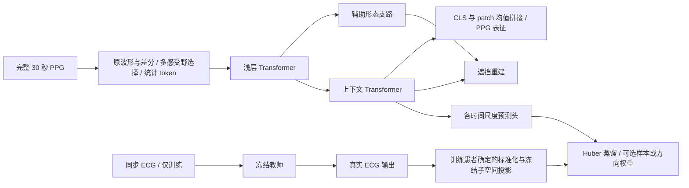

# TempoBridge-COSD

已实现 PW-KD 完整目标加权、COSD 教师子空间筛选、独立生理监督基线及下游评估。
批量实验入口见 [实验计划与审计](docs/EXPERIMENTS.md)，实现与边界见 [COSD](docs/COSD.md)，运行命令见 [生理参考与评估](docs/EVALUATION.md)，
完整迭代状态见 [开发记录](docs/DEVELOPMENT_PLAN.md)。Python 包名保持 `tempobridge`。

V3-A/B 增加 PPG 脉搏事件、ECG RR 分布和同记录相邻窗口的动态监督。原始采样率参考表、训练和评估命令见 [V3 事件迁移](docs/V3_EVENT_TRANSFER.md)。

**ECG 辅助训练、PPG 单模态推理的可观测教师目标研究基座。**

TempoBridge 实现一条可以执行和审计的研究路线：先学习 PPG 本身的表示，
再用患者交叉拟合估计 ECG 特征方向的可预测性，向学生迁移真实 ECG 教师在保留方向上的投影。
PW-KD 保留完整教师向量，仅调整样本权重；COSD 筛选目标方向，并保留独立患者审计。
主要假设是：减少难以从 PPG 预测的教师目标，可能缓解负迁移；可预测性本身并不证明下游效用。
这是假设，不是已经证明的新理论或顶会性能结论。仓库未包含临床数据或真实数据预训练权重。

## 架构



- 主实验配置使用 `model.encoder="selective"`：6 层 Transformer、维度 256、8 头，前 2 层受保护；RMSNorm、带 XPos 缩放的旋转位置编码、SwiGLU。
- 新 tokenizer 保留原波形、相邻差分、patch 均值和标准差四路信息，原波形与差分分别通过低维多感受野分支，再按 patch 和通道选择融合。借鉴 [Selective Kernel Networks](https://arxiv.org/abs/1903.06586) 的 Split–Fuse–Select 算法，增加可见输入上的全局/局部描述及覆盖率处理；不是只拼接三个卷积输出。
- 默认 `selective_kernel_sizes=[9,21,41]` 的单位是采样点，`selective_width=32`；每条信号支路先融合为 32 维，再与统计支路共同投影回 D 维，不增加 Transformer 的 patch token 数。输出是连续向量，没有离散码本或词表。
- `data.window_mode="full"`、`scales_seconds=[30.0]` 使用完整同步 30 秒记录；主配置均统一为 50 Hz、patch=10。加载器严格检查长度，过长不自动裁剪、过短不补齐。2 秒/8 秒裁剪仅保留在 `configs/ablation_2s8s.json`。
- 默认保持固定 `patch_size` 对应的物理时长，`num_tokens=0` 允许 token 数随窗口长度变化。不同蒸馏尺度分别编码，不通过强制缩放成 32 个 token 改变时间含义。
- 默认 `feature_pool="combined"` 拼接完整编码器的 CLS 表征与 patch token 均值，得到 512 维输出。浅层形态支路用于辅助重建，不参与该默认拼接；可选 `cls`、`mean` 或 `morph_context` 输出。
- `feature_layer=-1` 使用最终层；也可选择从 0 开始编号的层快照。当前仍计算完整编码器，选择浅层输出不等于减少计算。
- PPG 自监督更新整个学生；ECG 蒸馏默认只更新上下文层和预测头。
- 可选裁剪消融中，每个尺度分别裁剪并编码，同尺度 ECG/PPG 使用同一时间起点；两个尺度独立采样起点，短窗不保证嵌套在长窗中。
- 校准预测器按患者划分，目标归一化在每个拟合折内完成；评分按患者平衡。
- 校准与 KD 使用同一个最终 context patch 均值接口（默认 256 维）；导出池化默认仍为 512 维，二者不会混用。
- COSD 使用互斥的 basis/discovery/audit 患者；audit 不参与方向选择。实际 rank 可以为零，届时保留 PPG 自监督。
- 无 ECG 或零权重样本仍参加 PPG 自监督。权重固定，不通过蒸馏损失学习。
- 对外 `forward(ppg)` 只接受 PPG。导出文件不含教师、校准器、蒸馏头或重建头权重。

算法模块以 TempoBridge 命名并独立实现，保留本项目的选择性蒸馏、跨患者校准和浅层梯度保护。
新增的感受野选择器位于浅层保护边界之前，默认由 PPG 自监督更新；ECG 蒸馏不直接更新它。
这是选定组件的组合与适配，不是整篇论文的复现，也不表示已有性能优势。
旧配置或 checkpoint 未包含 `encoder` 字段时，`ModelConfig.from_dict` 仍选择原有 `local` 编码器。
`multiview` 单核编码器和 `local` 历史编码器仍可用；不同编码器权重不能直接互换，切换架构后重新预热、训练教师并校准。
详见 [编码器结构与配置](docs/ENCODER.md)、[方法与数学边界](docs/METHOD.md)、[研究与实验设计](docs/RESEARCH.md)。

## 安装

Python >= 3.10，PyTorch >= 2.4。请先按硬件安装 PyTorch，再安装项目。
本地使用独立 `.venv`；不会改动原有 Python 环境。

```powershell
cd TempoBridge-COSD
python -m venv .venv
.\.venv\Scripts\python.exe -m pip install torch --index-url https://download.pytorch.org/whl/cpu
.\.venv\Scripts\python.exe -m pip install -e ".[dev,data]"
```

上述安装用于 CPU 跑通验证。实际服务器训练时按服务器硬件另行安装合适的 CUDA 版 PyTorch。
仓库不要求 D 盘或特定用户目录，所有数据、输出和 checkpoint 路径均为 CLI 参数。
Linux/macOS 使用 `python3 -m venv .venv`、`source .venv/bin/activate` 后运行相同的 pip/CLI 命令。
请使用独立环境，不要启用 `--system-site-packages`，以避免继承系统 Anaconda 的数值运行库冲突。
下面的 `python` 均指已安装本项目的环境；Windows 也可以直接使用 `.\.venv\Scripts\python.exe`。
如本地已创建 `.venv-cpu`，也可使用 `.\.venv-cpu\Scripts\python.exe`。
迁移项目时重新创建虚拟环境，不复制 `.venv` 或 `.venv-cpu`。

## 一次运行完整闭环

```powershell
python scripts/smoke.py --output runs/smoke
python -m pytest -q
```

smoke 自动执行：合成数据 → 数据审计 → PPG 预热 → ECG 预训练 → 校准 → 蒸馏 → 导出 → 提取测试表示。
合成信号仅验证工程和优化流程，**不能作为生理有效性或临床任务提升的证据**。
`configs/smoke.json` 用小模型和 CPU；`configs/base.json` 用正式架构、自动选择设备及 bf16。
另提供 `configs/laptop_8gb.json` 供将来选择：同一正式架构，batch=4、累积8次，等效 batch=32；本次不在用户显卡上训练。
梯度累积不等价于含 batch statistics 的所有算法；本模型使用逐样本归一化，且不依赖 batch 对比负样本。
只有 PPG 重建性能被用作训练期验证指标，没有绑定任何下游任务。

## 使用自己的同步数据

已有 PulseBound HDF5、原始 MIMIC WFDB 或本地 VitalDB `.vital`，先按
[PulseBound 数据接入指南](docs/PULSEBOUND_DATA.md) 转换/建立索引，使用 `configs/pulsebound_50hz.json`。
也可继续按 [数据约定](docs/DATA.md) 准备 CSV manifest 和 NPZ 波形，并预先按患者划分训练/验证/测试。
主实验要求每条记录恰好 30 秒。50 Hz 配置输入 1500 点，与 PulseBound 主预训练的存储窗口时长和采样率相同；
本项目仍用 10 点 patch（150 个 patch token），PulseBound 用 50 点 patch（30 个 PPG patch token）。
本项目继续使用随机掩码重建和 ECG 选择性蒸馏，不采用其连续后缀掩码和未来心搏状态预测任务。

```powershell
python -m tempobridge audit-data --config configs/base.json --manifest data/manifest.csv
python -m tempobridge pretrain --config configs/base.json --manifest data/manifest.csv --modality ppg --output runs/ppg
python -m tempobridge pretrain --config configs/base.json --manifest data/manifest.csv --modality ecg --output runs/ecg
python -m tempobridge calibrate --config configs/base.json --manifest data/manifest.csv --student runs/ppg/last.pt --teacher runs/ecg/last.pt --output runs/calibration.json
python -m tempobridge distill --config configs/base.json --manifest data/manifest.csv --student runs/ppg/last.pt --teacher runs/ecg/last.pt --calibration runs/calibration.json --output runs/distill
python -m tempobridge export --checkpoint runs/distill/last.pt --output runs/encoder.pt
python -m tempobridge features --checkpoint runs/encoder.pt --manifest data/manifest.csv --split test --output runs/test_features.npz --device cuda
```

原生 ECG 预训练提供一个完整、可执行的教师来源，并不意味着它已经是强 ECG foundation model。
可以替换为公开预训练的单导联 ECG 教师，见 [外部教师接口](docs/TEACHER.md)。
所有有效性结论都依赖教师质量、数据覆盖及实验对照。

## Python 推理接口

```python
import torch
from tempobridge.inference import load_encoder

encoder = load_encoder("runs/encoder.pt", device="cuda")
ppg = torch.randn(4, 1, 1500, device="cuda")  # 30 seconds at configured 50 Hz
with torch.inference_mode():
    embedding = encoder(ppg)                # [4, 512] for the base configuration
    temporal = encoder.forward_features(ppg)["tokens"]
```

推理输入必须使用导出配置中的 PPG 采样率，长度为 patch_size 的整数倍，至少包含两个 patch。
上例匹配主实验的 30 秒输入；直接调用编码器虽可接受其他合法长度，但不等于已验证跨时长泛化。
`features` CLI 通过数据加载器执行导出配置的 `full`/`crop` 窗口约定。
若显式设置 `num_tokens=32`，输入还必须满足 `length=32*patch_size`；模型不会自动重采样或重划 patch。
`features` 不向模型输入 ECG 波形，仅保留可用性及质量元数据用于分组报告。模型是窗口级双向编码器，不声称在线因果预测。

## 校准与消融

输入协议与结构对照配置：

| 配置 | 输入与编码器 |
|---|---|
| `configs/pulsebound_50hz.json` | 50 Hz 完整 30 秒，`selective` 自适应融合 |
| `configs/baseline_multiview_30s.json` | 同为完整 30 秒，原 `multiview` 单核编码器 |
| `configs/ablation_selective_mean_30s.json` | 同为完整 30 秒，多感受野但采用固定平均融合 |
| `configs/ablation_selective_global_30s.json` | 同为完整 30 秒，选择器仅使用全局描述，关闭局部上下文 |
| `configs/ablation_selective_no_coverage_30s.json` | 同为完整 30 秒，关闭覆盖率补偿与选择先验，仍阻断隐藏输入 |
| `configs/ablation_2s8s.json` | `window_mode="crop"`，2 秒/8 秒裁剪，单独检验观察时长变化 |

结构和输入时长应分别消融。30 秒输入对齐不等于网络、清洗和训练目标与 PulseBound 全部相同。
固定平均消融保留选择器参数但不执行选择器；参数存储相同不代表计算量或有效训练参数相同。
本项目的 VitalDB 转换和缺失处理仍有已记录的差异，不能宣称逐样本复制其历史语料。

`train.transfer_mode` 支持：

| 配置 | 行为 |
|---|---|
| `calibrated` | ECG 可靠性 × 尺度/PPG 质量组可预测性 |
| `all` | 所有可用 ECG 等权蒸馏 |
| `quality` | 仅按 ECG 可靠性加权 |
| `random` | 在 batch 内打乱可预测性权重；属于近似覆盖对照 |
| `none` | 不计算蒸馏，继续 PPG 自监督 |

对照仍复用同一校准文件中的目标标准化，避免改变目标数值尺度。
`protect_shallow=false` 关闭梯度保护；`model.morphology_branch=false` 关闭辅助形态重建。
默认 `combined` 输出仍为 CLS 与 patch 均值拼接，不因关闭形态支路改变维度。
架构、时间尺度、训练数据或教师变更后，重新预热/校准；已有 artifact 不允许悄悄复用。
`random` 不保证在不同 ECG 质量分布下总有效权重完全相同，严格预算对照需额外匹配。

## 断点续训与记录

```powershell
python -m tempobridge pretrain --config configs/base.json --manifest data/manifest.csv --modality ppg --output runs/ppg --resume runs/ppg/last.pt
```

蒸馏续训保留原蒸馏命令的所有参数并加 `--resume runs/distill/last.pt`。
保存模型、预测头、优化器、调度器、AMP scaler、Torch RNG、epoch 和来源哈希。
支持 **epoch 边界**续训；中途崩溃会从上一个完整 epoch 重新执行。
测试覆盖 CPU 下含 dropout 的逐参数一致恢复。CUDA 不承诺跨硬件逐 bit 一致。
改变总 epochs 会改变学习率计划，因此续训严格要求原配置一致。
用 `--stop-after 1` 可在不改变计划的情况下提前保存，之后恢复。

每个训练目录包含 `config.json`、`environment.json`、`provenance.json`、`metrics.jsonl`、`last.pt`，
有验证集时还保存 `best.pt`。不自动发布、上传或推送任何结果。

## 仓库结构

```text
src/tempobridge/     网络、数据、教师、校准、训练、导出、CLI
configs/            基础实验和快速验证配置
scripts/            完整闭环与性能测量
tests/              信息边界、梯度、患者划分、校准、续训、导出测试
docs/               数学说明、研究定位、数据/教师接口、验证记录
.github/            CI、issue 和 PR 模板
```

本版本支持单机单 GPU/CPU、AMP、梯度累积、按需 NPZ/HDF5 读取、紧凑分组索引和无放回来源混合采样；
尚未实现 DDP、多节点及大规模真实数据吞吐验证。
`scripts/benchmark.py` 是可选的前向/反向性能测量工具，本次不执行 GPU benchmark。
它是可实验的研究基座，不是已经完成真实数据预训练的成品基础模型。

更多约束与验收证据见 [验证记录](docs/VALIDATION.md)。
